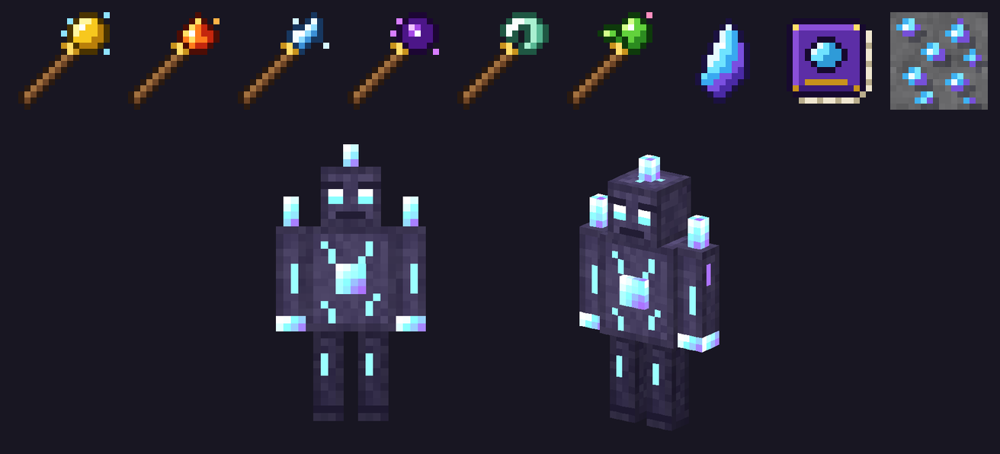

# Elemental Relics

A Minecraft Bedrock / MCPE add-on: six spell-casting staffs, a mana bar, a new
ore and a new cave mob. Works in survival and creative, single player and
multiplayer.



## Install

1. Download [`dist/ElementalRelics.mcaddon`](dist/ElementalRelics.mcaddon) to
   your phone or tablet.
2. Open the file with Minecraft. It imports two packs: **Elemental Relics** and
   **Elemental Relics Resources**.
3. Create or edit a world and turn on both: *Behavior Packs → Elemental Relics*
   and *Resource Packs → Elemental Relics Resources*.

No experimental toggles are needed. Requires **Minecraft 1.21.90 or newer**
(any 26.x version is fine).

If your device will not open `.mcaddon` files, import
`dist/ElementalRelics_BP.mcpack` and `dist/ElementalRelics_RP.mcpack` one after
the other instead.

## Playing

You get a **Relic Codex** the first time you join a world with the add-on. Use
it to read about every staff in-game.

- **Cast:** hold a staff and *use* it (touch: press and hold the screen, or tap
  when aiming at a nearby block; mouse: right-click; controller: left trigger).
- **Second spell:** *sneak* while using it.
- **Mana:** spells cost mana (max 100, +5 per second). While you hold a staff
  the bar shows above the hotbar along with both spell names and costs.
  Creative mode casts for free.

| Staff | Use | Sneak + use | Catalyst |
| --- | --- | --- | --- |
| Storm | **Lightning Strike** (20): a bolt where you point, up to 48 blocks | **Thunderstorm** (60): a bolt on every monster within 24 blocks | Lightning Rod |
| Inferno | **Fire Bolt** (12): a flying bolt that bursts and ignites, never breaks blocks | **Flame Nova** (50): a ring of fire 7 blocks out | Blaze Powder |
| Frost | **Frost Ray** (12): slows and hurts a mob, freezes water into a bridge, hardens lava | **Blizzard** (55): freezes monsters around you and ices the water underfoot | Packed Ice |
| Void | **Blink** (18): teleport up to 32 blocks; blink into the air and you float down | **Singularity** (60): a rift that drags in mobs and dropped items, then collapses | Ender Pearl |
| Gale | **Gust** (10): throws back everything in front of you | **Sky Leap** (25): launches you where you look, then you glide down | Feather |
| Verdant | **Mend** (25): heals you and nearby players, cures poison and wither | **Overgrowth** (40): ripens crops, scatters flowers, roots monsters | Emerald |

Area spells never hurt players, villagers, golems or tamed pets.

### Getting the staffs in survival

- **Arcane Ore** generates in stone and deepslate below Y 48 and glows faintly.
  Mining it drops 1–3 **Arcane Shards** and some XP.
- The **Crystal Sentinel** spawns in dark caves: 50 health, hits hard and its
  blows slow you. It drops shards, sometimes a diamond, and killing one
  restores 40 mana.
- Craft a staff on a crafting table (the Codex shows this too):

  ```
  [       ] [ Shard ] [Catalyst]
  [       ] [ Stick ] [ Shard  ]
  [ Stick ] [       ] [        ]
  ```

- Relic Codex: one Book + one Arcane Shard, anywhere in the grid.

### Commands (cheats on)

```
/scriptevent relics:kit      every staff, the codex and 16 shards
/scriptevent relics:mana     refill your mana
/give @s relics:storm_staff  (also inferno_, frost_, void_, gale_, verdant_staff)
/summon relics:crystal_sentinel
```

## How it was checked

This add-on has **not been run inside Minecraft** – there is no game in the
environment it was built in. What was verified instead:

- Scripts type-check against Mojang's official `@minecraft/server` typings for
  both 2.0.0 (the oldest supported) and 2.11.0 (the newest stable).
- Every vanilla item, block, entity, effect and block-state name the add-on
  refers to exists in Mojang's `@minecraft/vanilla-data` 1.26.60.
- Mojang's Creator Tools validator (`mct validate all`) reports no errors on
  the packaged `.mcaddon`.
- `tools/simulate` casts all 12 spells at 8 different aims against a fake
  world, including unloaded chunks and effect-immune mobs, and checks the
  results (40 checks, all passing).

So the files are well-formed and the logic runs, but balance, particle looks,
knockback strength, mob behaviour and the exact touch gesture for casting are
untested in a live world. Things most
likely to need tuning after a first play: Sky Leap distance, Gust strength, ore
frequency and Sentinel spawn rate.

## Project layout

```
behavior_pack/   items, block, entity, recipes, loot, world generation, scripts
resource_pack/   textures, entity model + animations, names
tools/make_textures.py   regenerates every texture (pixel art is defined in code)
tools/build.py           packages dist/*.mcaddon and dist/*.mcpack
tools/simulate/          runs the spells outside Minecraft
```

Rebuild after editing:

```
python3 tools/make_textures.py      # only if you changed the art (needs Pillow)
python3 tools/build.py
node --import ./tools/simulate/register.mjs tools/simulate/run.mjs
```

Spell numbers (mana, cooldown) live in `behavior_pack/scripts/staffs.js`; each
element's spells are in `behavior_pack/scripts/spells/`.
